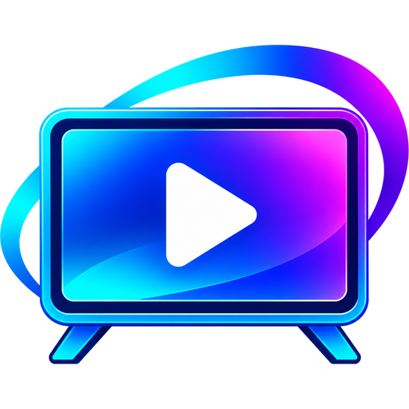

# Stick Player



Fire TV（Fire OS）向けの動画プレーヤーです。
[VLC for Android](https://code.videolan.org/videolan/vlc-android) 3.7.2 をもとにした**非公式の改造版**です。

> **ご注意**
> Stick Player は VideoLAN とは関係がなく、VideoLAN が承認・支援しているものではありません。
> VLC、VLC media player、VideoLAN およびコーンのロゴは VideoLAN の商標です。
> 不具合や要望は VideoLAN ではなく、このリポジトリの [Issues](https://github.com/Posn973/StickPlayer/issues) にお願いします。

---

## 主な機能（VLC for Android からの変更点）

### 再生
- **AV1 のハードウェア再生**：VLC 3 系では AV1 がソフトウェアデコードになり、Fire TV Stick ではカクつくことがありました。Android のハードウェアデコーダー（MediaCodec）で再生するようにしました。
- **「プレイリストの解析をしない」設定**：ローカルのプレイリストを開いたとき、全項目の解析を待たずにすぐ再生を始められます。
  （設定 → インターフェース → ビデオ。初期値はオフ）

### フォルダー画面の並び替え
並び替えメニューを、向きごとに分けた項目にしました。今の並び替えには ✓ が付きます。

| 項目 |
|---|
| 名前（A→Z） / 名前（Z→A） |
| ファイルサイズ（大きい順） / ファイルサイズ（小さい順） |
| 更新日（新しい順） / 更新日（古い順） |
| ランダム |

- 数千件のフォルダーでも、並び替えはすぐに反映され、先頭の項目にフォーカスします。
- ランダムの並び順は、次に「ランダム」を押すまで変わりません（再生から戻っても同じ順番です）。
- 一覧の各ファイルに、サイズと更新日を表示します（例：`1.24 GB · 1:23:45 · 2026/11/03`）。
- **SMB（NAS）上のファイル**も、サイズと更新日で並べ替えられます。

### そのほか
- アプリ名・アイコン・パッケージ名を変更しました（VLC と共存できます）。
- フィードバック／クラッシュレポートの送信（VideoLAN 宛て）と、VideoLAN への寄付の案内を無効にしました。

---

## 対応機種

- Fire OS の Fire TV（例：Fire TV Stick 4K Max 第2世代）で動作を確認しています。
- Vega OS の端末（Fire TV Stick 4K Select、2026年の Fire TV Stick HD など）では動きません。

---

## このリポジトリの内容

```
patches/
  vlc/   VLC 本体（libvlcjni/vlc）に当てるパッチ
  app/   アプリ（vlc-android）に当てるパッチ
images/  アイコン画像
```

元のソースコードは含んでいません。VLC for Android 3.7.2 のソースに、ここのパッチを番号順に当てて使います。

---

## ビルド方法

WSL2（Ubuntu）などの Linux 環境で行います。

### 1. 必要なもの
- JDK 17、Android SDK、Android NDK 21.4.7075529（32bit / armeabi-v7a 用）
- ビルド用ツール：
  ```
  sudo apt install -y automake ant autopoint cmake build-essential libtool-bin patch pkg-config \
    protobuf-compiler ragel subversion unzip git openjdk-17-jdk flex python3 python3-venv wget \
    gettext meson ninja-build nasm gperf bison zip xsltproc
  ```
- 環境変数 `ANDROID_SDK`（= `ANDROID_HOME`）と `ANDROID_NDK`
- `git config --global user.name` / `user.email`（ビルド中のパッチ適用に必要）

### 2. ソースの取得
```
git clone https://code.videolan.org/videolan/vlc-android.git
cd vlc-android
git checkout -b stickplayer 3.7.2
buildsystem/compile.sh -a armeabi-v7a     # 1回目：VLC 本体のソースが自動で取得されます
```

### 3. パッチを当てる
VLC 本体（`vlc-android/libvlcjni/vlc` で実行）：
```
patch -p1 < /path/to/patches/vlc/01-av1-mediacodec.patch
patch -p1 < /path/to/patches/vlc/02-smb-size-vlc.patch
patch -p1 < /path/to/patches/vlc/03-smb-mtime-vlc.patch
```

アプリ（`vlc-android` で実行）：
```
for p in /path/to/patches/app/*.patch; do git apply "$p"; done
```

### 4. ビルドとインストール
```
buildsystem/compile.sh -a armeabi-v7a
adb connect <Fire TV の IP アドレス>:5555
adb install StickPlayer-3.7.2-all.apk
```

---

## ライセンス

- Stick Player は VLC for Android の改造版で、**GNU General Public License v2.0（またはそれ以降）** で配布します。
- 各パッチは、変更する元のファイルと同じライセンス（GPL または LGPL）に従います。
  VLC 本体（libVLC）は LGPL v2.1 以降です。
- 元のソフトウェアの著作権は VideoLAN と VLC の著作者にあります。

## 謝辞

[VideoLAN](https://www.videolan.org/) と VLC for Android の開発者のみなさんに感謝します。
